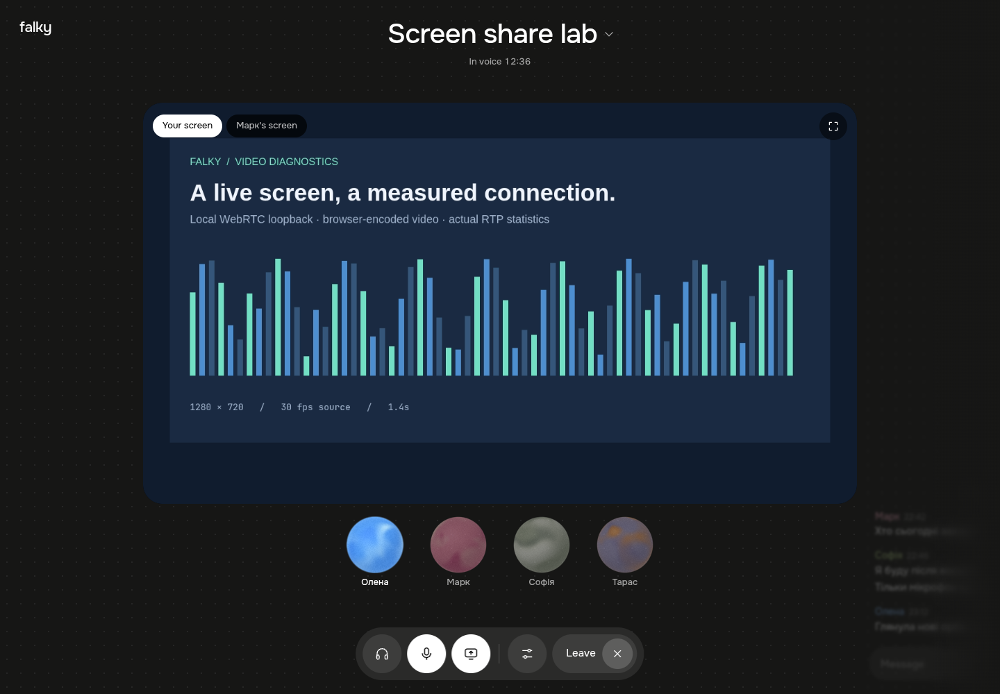
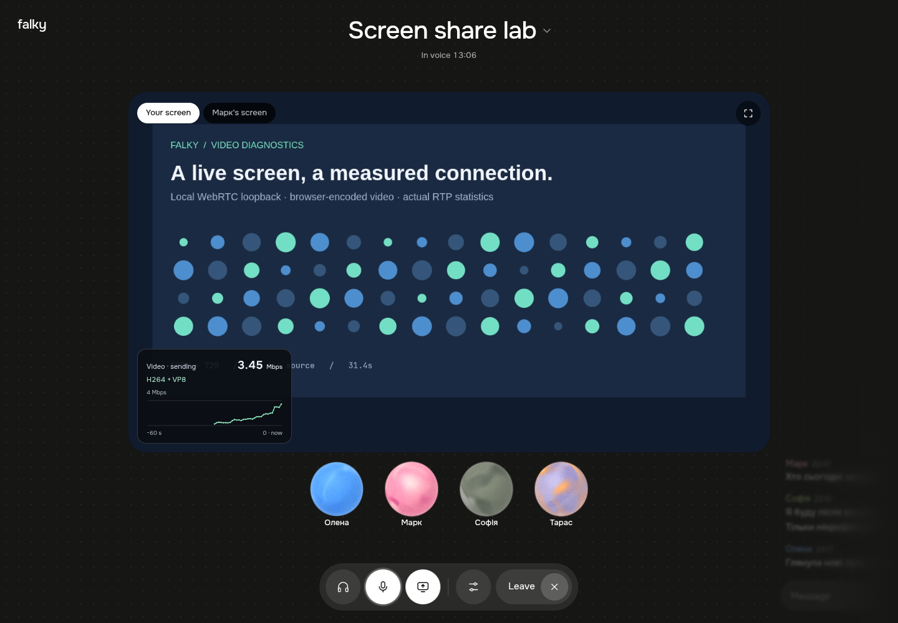
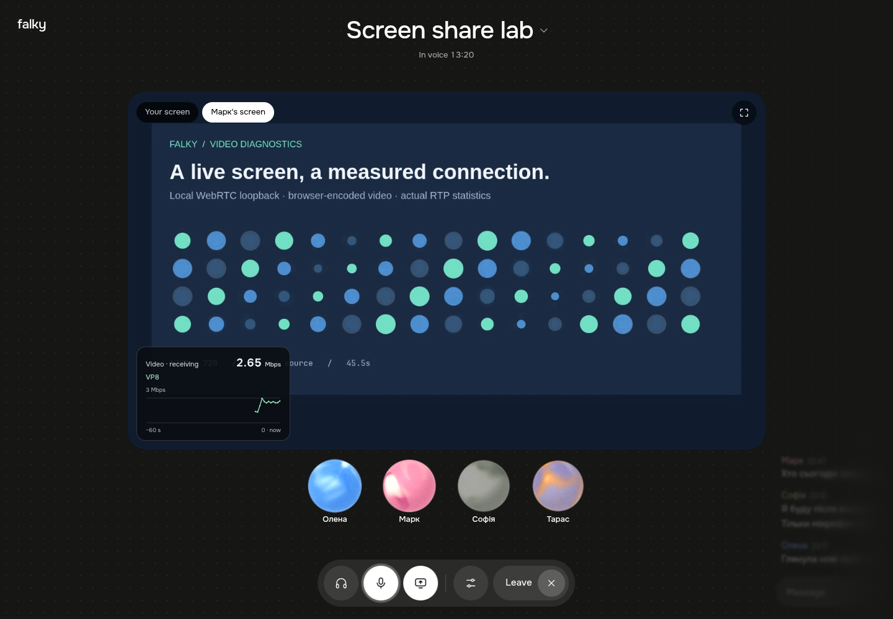
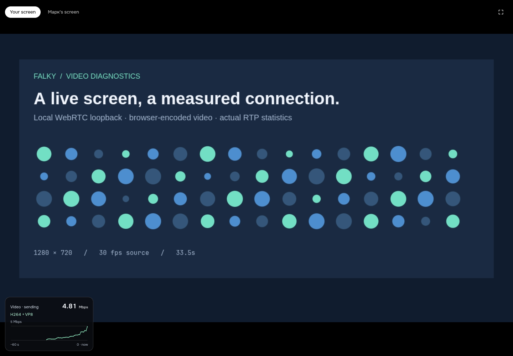
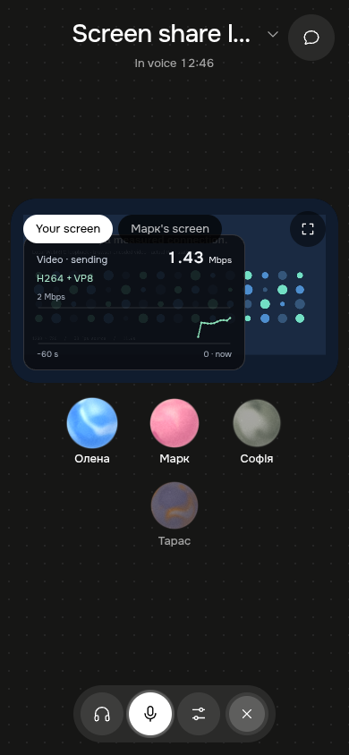
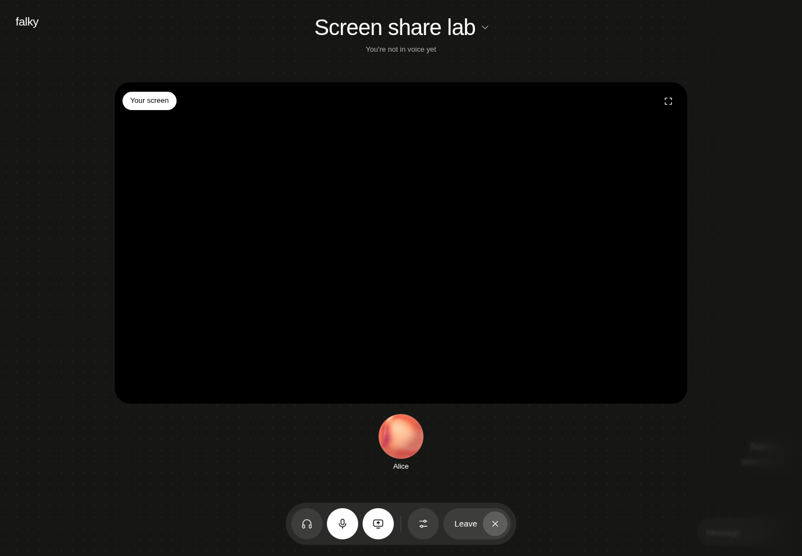

# Development screen-share statistics

These screenshots show the implemented UI in Chromium, with the existing design
fixture supplying people and rooms. An animated canvas supplies the video; the
small overlay in the lower-left corner is the new bitrate graph. Its values come
from real local WebRTC traffic, not fixture bitrate samples.

The sending view uses two simultaneous loopback connections: H.264 on the primary
sender and VP8 on a compatibility sender, registered on a LiveKit `LocalVideoTrack`.
The receiving view uses a `RemoteVideoTrack` for the VP8 connection. This exercises
actual browser RTP reports and the adapter's aggregation, but does not prove
mixed-browser fallback negotiation through a deployed LiveKit server.

| Before | Sending H.264 + VP8 |
| --- | --- |
|  |  |

| Receiving VP8 | Fullscreen |
| --- | --- |
|  |  |

The graph starts empty and fills with measured samples; a new selected share
starts a fresh graph. The number is video RTP payload Mbps, excluding audio and
network headers. Missing statistics produce gaps, not zero-valued samples.

| Narrow viewport | Production gate |
| --- | --- |
|  |  |

The production image uses the real UI compiled in production mode with a test
track. Browser requests are intercepted locally under the production hostname;
this is not a screenshot of the deployed site. The hostname checks demonstrate:

| Hostname, production-mode bundle | Overlay | Statistics calls in 2.4 seconds |
| --- | --- | --- |
| `falky.lunari.win` | Absent | 0 |
| `preview.example.test` | Absent | 0 |
| `dev.falky.lunari.win` | Visible | 3 |

Verification: `make check` passes, including all 70 frontend tests and the
production build. Browser checks cover sending/receiving codec labels, fullscreen,
narrow viewport containment, and stopping statistics polling after sharing ends.
Unit tests cover exact bitrate arithmetic, fallback accounting, inactive senders,
counter resets, unavailable data, graph gaps, track replacement, and asynchronous
cleanup. Standards and specification reviews reported no actionable findings.
